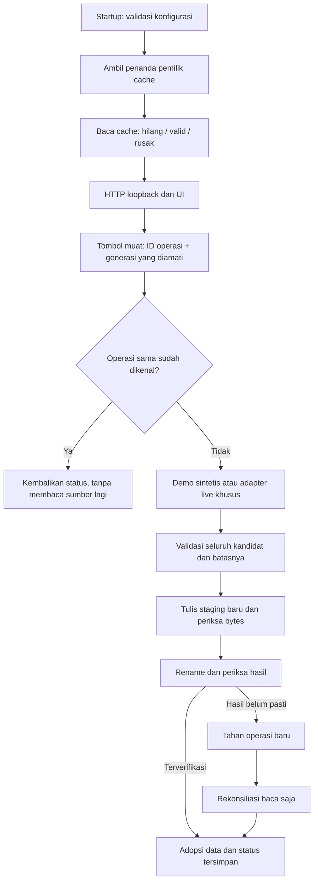

# Alur kode Loker Lens

## Pembacaan dan penyimpanan

`createApplication` memiliki state sendiri. Factory server tidak memuat cache atau membuka listener saat diimpor. `main` membaca konfigurasi, membuka cache khusus mode, lalu mengikat server ke `127.0.0.1`.

`start` menerima UUID operasi, generasi cache yang diamati, dan konfirmasi penggantian cache rusak bila diperlukan. Replay UUID yang sama harus memiliki intent yang sama. Replay tidak membaca sumber lagi. Start lain ketika pembacaan aktif bergabung dengan status operasi yang sedang berjalan.

Adapter mengumpulkan kategori dan lokasi terlebih dahulu, kemudian halaman post. Angka halaman, daftar, record, tanggal, tautan, byte dan jumlah record diperiksa. Batas halaman menghasilkan informasi cakupan; data malformed menyebabkan kegagalan seluruh kandidat. URL sumber tidak dipakai sebagai URL fetch tambahan.

`snapshotDecoder` memeriksa penanda aplikasi/mode/versi, schema seluruh record dan kecocokan sinyal bidang dengan hasil perhitungan ulang. `SafeCache` memeriksa cache lama, menulis staging eksklusif, fsync, memeriksa bytes, lalu melakukan rename. Data terkonfirmasi baru berubah setelah hasil itu terverifikasi.

Kegagalan sebelum rename mempertahankan hasil lama. Jika rename mungkin sudah terjadi, cache memegang kandidat dan hash lama sebagai dua hasil yang diketahui. `reconcile` membaca bytes saat ini: hash baru mengonfirmasi tersimpan, hash lama mengonfirmasi tidak tersimpan, nilai lain mempertahankan ketidakpastian. Pemeriksaan, penggantian dan pelepasan pemilik saling mengecualikan selama operasi filesystem menunggu.

Pembatalan menghentikan fetch milik operasi dan memeriksa ulang sinyal setelah adapter selesai. Adapter terlambat yang mengabaikan abort tetap tidak boleh menyimpan kandidat. Pembatalan tidak diterima setelah fase penyimpanan dimulai.

## Browser

`public/model.mjs` memvalidasi snapshot/status sebelum UI mengadopsinya. `DashboardClient` menjaga ticket baca/status, epoch tindakan dan identitas instance server. Balasan lama tidak mengganti snapshot lebih baru atau server pengganti yang sudah diamati.

Timeout mencakup isi respons setelah headers. Body dibaca bertahap dengan batas byte; reader dibatalkan dan dilepas pada kegagalan. Poll hanya satu permintaan pada satu waktu dan berhenti saat tidak ada operasi yang perlu diperiksa. `pagehide` membatalkan request dan timer milik halaman.

Balasan start yang belum pasti menyimpan intent semula di memori halaman. Pemeriksaan status tidak mengirim ulang start. Setelah status tidak menemukan operasi, pengguna dapat mengulang permintaan yang sama secara eksplisit. Tombol muat baru tetap diblokir selama intent itu belum selesai diperiksa.

Filter menggunakan data terakhir yang terkonfirmasi. Dua input memiliki timer debounce terpisah; reset membatalkan keduanya. Tanggal mengikuti kalender Jakarta. Cuplikan memakai pemetaan indeks hasil normalisasi kembali ke grapheme teks asli, sehingga teks beraksen tidak menggeser potongannya.

## Permukaan HTTP

Rute static hanya lima aset yang disebut dalam allowlist. Berkas sumber server, tes, konfigurasi dan cache tidak disajikan. Host harus sesuai listener lokal. POST membutuhkan Origin persis sama dan tidak menerima `Sec-Fetch-Site` lintas situs. JSON request dibatasi 2 KiB. Respons memakai `no-store`, `nosniff` dan CSP lokal.

| Rute | Fungsi |
| --- | --- |
| `GET /api/health` | Identitas aplikasi dan mode |
| `GET /api/state` | Snapshot terkonfirmasi beserta status |
| `GET /api/status` | Status saat ini; UUID opsional pada `operationId` |
| `POST /api/sync` | Mulai atau replay operasi eksplisit |
| `POST /api/cancel` | Batalkan pembacaan sebelum penyimpanan |
| `POST /api/reconcile` | Periksa hasil simpan tanpa penulisan ulang |
| `GET /demo/source/:id` | Halaman contoh untuk post demo tersimpan |

Semua API baca tidak memulai sinkronisasi. Pesan kesalahan yang tidak dikenal diganti pesan aman; path lokal dan balasan provider mentah tidak dikirim ke browser.
