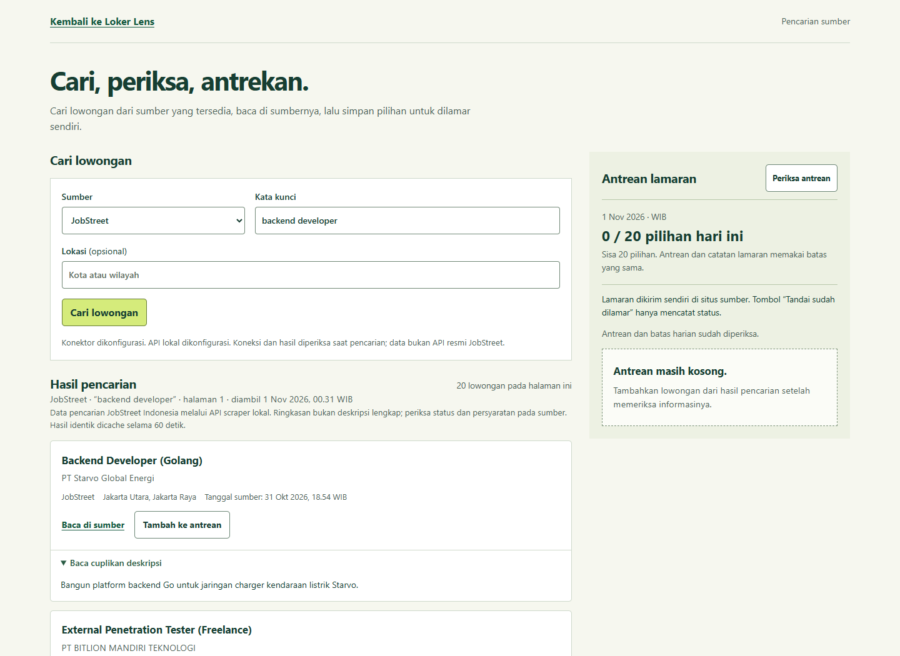
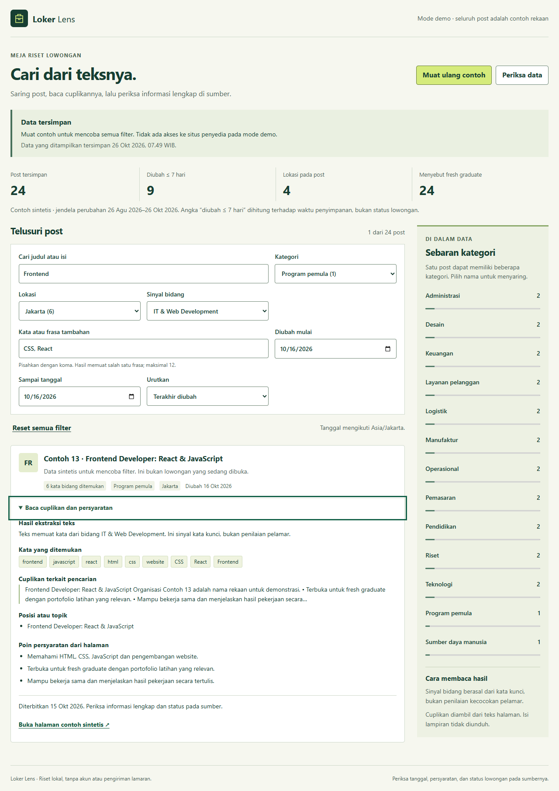
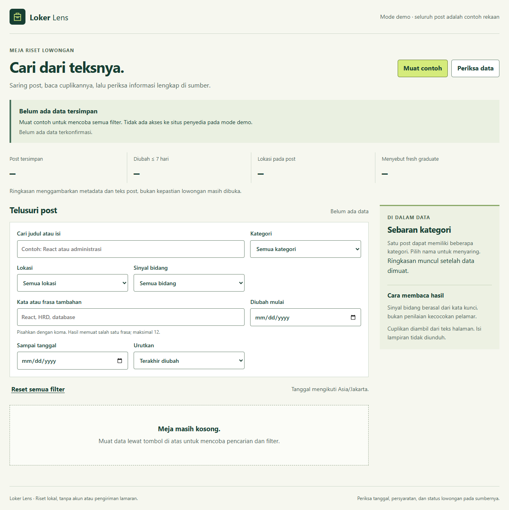
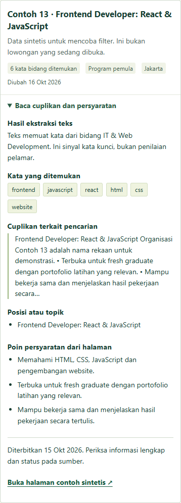

# Loker Lens

Pencarian JobStreet Indonesia lewat API scraper lokal, antrean maksimal **20 pilihan per hari WIB**, dan catatan lamaran yang tetap tersimpan setelah restart. Halaman riset post lama tetap tersedia di halaman utama.

**Status konektor:** JobStreet sudah diuji dengan 20 kartu lowongan nyata. Glints belum tersedia karena pemeriksaan API mendapat HTTP 403. Program menampilkan keadaan ini secara langsung; tidak menggantinya dengan data demo. Pengiriman lamaran dilakukan sendiri pada situs sumber. Kolektor harian mengisi antrean, bukan mengirim formulir lamaran.



Screenshot di atas diambil dari aplikasi berjalan pada 1 November 2026. Hasil bergantung pada waktu pencarian dan bukan jaminan lowongan masih dibuka. [Tampilan ponsel](docs/screenshots/jobstreet-mobile.png) dan [status Glints yang belum tersedia](docs/screenshots/glints-status.png) juga diambil dari aplikasi.

## Pencarian API dan antrean harian

Siapkan Node.js **22.14+**, Python **3.13 x64**, Git, dan PowerShell. Dari direktori proyek, jalankan dua terminal:

```powershell
# Terminal 1: setup pertama otomatis, lalu API scraper lokal berjalan.
.\scripts\Start-JobStreet.ps1
```

```powershell
# Terminal 2: dashboard dan REST API Loker Lens.
.\scripts\Start.ps1
```

Buka **http://127.0.0.1:8132/pencarian**. Isi kata kunci dan lokasi opsional, cari, baca informasi di sumber, kemudian tambahkan pilihan ke antrean. **Tandai sudah dilamar** memerlukan konfirmasi bahwa kamu sudah mengirimnya sendiri; tombol ini hanya mencatat status lokal. Ctrl+C pada masing-masing terminal menghentikan layanannya.

API JobStreet lokal memakai sumber [omkarcloud/jobstreet-scraper](https://github.com/omkarcloud/jobstreet-scraper) pada revisi tetap. Ini API pihak ketiga yang membungkus scraper, bukan API resmi JobStreet. [Catatan layanan](docs/JOBSTREET-SERVICE.md) menjelaskan revisi, lisensi MIT upstream, dependensi terkunci, transport, dan batas akses. Cache, virtual environment, dan berkas sementara berada di `.local/` pada direktori proyek; data pribadi antrean berada di `.data/board/`. Keduanya diabaikan Git dan tidak disajikan oleh HTTP.

Antrean menggunakan SQLite bawaan Node, tanpa instalasi database tambahan. Node 22.14 masih menampilkan peringatan experimental untuk modul ini. Identitas `provider + jobId` mencegah duplikat setelah restart. Penambahan dan penandaan memakai transaksi yang sama untuk membatasi total pilihan terjadwal dan lamaran tercatat menjadi 20 per hari WIB, termasuk dari proses kolektor lain. Riwayat yang sudah dilamar tetap disimpan; antrean yang belum dilamar boleh dihapus. Maksimal 2.000 catatan disimpan tanpa penghapusan riwayat otomatis.

## Pengumpulan otomatis harian

Jalankan sekali untuk menyiapkan layanan, tanpa mengambil lowongan:

```powershell
.\scripts\Start-JobStreet.ps1 -SetupOnly
```

Kemudian gunakan kriteriamu sendiri. Contoh berikut mengisi sisa kuota antrean dengan hasil terbaru yang cocok dengan pencarian penyedia, melewati duplikat dan riwayat lamaran:

```powershell
node scripts/Collect-Daily.mjs --query "backend developer" --location "Jakarta"
```

Kolektor memeriksa paling banyak lima halaman, masing-masing maksimal 20 kartu, dan tidak mengambil data lagi bila kuota hari itu penuh. Hasil dipilih menurut urutan penyedia, tanpa penilaian AI terhadap CV atau pengalaman. Layanan JobStreet milik kolektor dimulai bila perlu dan dihentikan setelah selesai; layanan yang sudah berjalan tidak dihentikan. Kegagalan sumber menghasilkan kode keluar gagal dan tidak menghapus pilihan yang sudah tersimpan.

Untuk mendaftarkan jadwal Windows setelah kata kunci, lokasi, dan waktu sudah kamu tentukan:

```powershell
.\scripts\Install-DailyTask.ps1 -Query "backend developer" -Location "Jakarta" -At '09:00'
```

Skrip tersebut membuat task `LokerLens-PencarianHarian` dan berkas kriteria lokal. **Task belum diaktifkan otomatis oleh pembuatan proyek ini.** Komputer harus menyala, terhubung internet, dan pengguna login. Skrip mengharapkan zona waktu komputer UTC+7; kuota selalu memakai Asia/Jakarta. Periksa atau hapus task melalui Windows Task Scheduler. [Panduan API dan alur kode](docs/BOARD-API.md) mencakup kontrak REST, file, transaksi, dan batas yang belum didukung.

## Riset post dari proyek sebelumnya

Penyaring teks post lowongan yang berjalan di komputer sendiri. Cari judul atau isi, gabungkan filter, lalu baca cuplikan dan persyaratan tanpa berpindah halaman. Data disimpan setelah berkas cache terverifikasi.

**Saat pertama dijalankan, aplikasi memakai mode demo dengan 24 post rekaan.** Mode ini tidak menghubungi situs lowongan. Adapter DISNAKERJA.COM tersedia sebagai pilihan terpisah untuk pembacaan manual.



Tampilan Chrome pada lebar 1280 piksel. Filter kategori, lokasi, bidang, frasa, dan tanggal menyisakan satu post sintetis; garis fokus terlihat pada kontrol detail.

<details>
<summary>Lihat keadaan kosong dan detail pada layar kecil</summary>



Keadaan awal sebelum ada cache terkonfirmasi, diambil dari halaman aplikasi yang berjalan.



Elemen kartu hasil selebar 358 piksel pada viewport Chrome 390 piksel. Gambar ini memperlihatkan detail post, bukan seluruh halaman mobile.

</details>

## Jalankan

Untuk halaman riset lama, gunakan **Node.js 22.14 atau lebih baru**. Tidak ada dependensi npm, server database, akun, atau API key yang perlu dipasang. Layanan Python hanya diperlukan untuk pencarian JobStreet.

```powershell
git clone https://github.com/zalamanga/loker-lens.git
cd loker-lens
node server.js
```

Buka **http://127.0.0.1:3000**, lalu klik **Muat contoh**. Halaman awal hanya membaca cache; pembacaan sumber selalu dimulai lewat tombol. Tutup server dengan **Ctrl+C** agar penanda pemilik cache dilepas.

Jika port 3000 sudah dipakai:

```powershell
$env:PORT = '3100'
node server.js
```

## Yang bisa dicoba

| Kebutuhan | Kontrol |
| --- | --- |
| Mencari teks | Judul/isi, dengan pencarian tanpa membedakan huruf besar dan aksen |
| Menyaring | Semua kategori, lokasi, tiga bidang, rentang tanggal perubahan |
| Menambah frasa | Maksimal 12 frasa dipisahkan koma; hasil memuat salah satunya |
| Mengurutkan | Terakhir diubah, lebih lama dahulu, judul A–Z |
| Membaca hasil | Sepuluh post per halaman, detail native, cuplikan, topik, persyaratan |
| Memeriksa asal | Halaman contoh lokal pada mode demo; tautan sumber asli pada mode live |
| Mengelola pembacaan | Progress, pembatalan sebelum penyimpanan, pemeriksaan hasil simpan |

Filter tetap bisa dipakai ketika pembacaan baru berlangsung. Kesalahan sumber atau pembatalan mempertahankan data terakhir yang sudah tersimpan. Reset membatalkan kedua timer input pencarian agar filter lama tidak muncul lagi.

## Baca hasil sesuai batasnya

- **“Diubah ≤ 7 hari”** memakai waktu perubahan post dibanding waktu penyimpanan. Ini tidak memastikan lowongan masih terbuka.
- Sinyal IT/Web, Teknik Informatika, dan HR berasal dari kata kunci pada teks. Ini bukan skor kecocokan pelamar.
- Cuplikan adalah hasil ekstraksi. Teks panjang dibatasi pada 18.000 unit UTF-16 tanpa memotong grapheme; label menandai pembatasannya.
- Lampiran hanya dideteksi. Aplikasi tidak mengunduh PDF, membaca isi Drive, mengirim lamaran, atau masuk ke akun penyedia.
- Satu post dapat memiliki beberapa kategori; jumlah kategori tidak harus sama dengan jumlah post.
- Nol post yang terkonfirmasi ditampilkan sebagai **0**. Cache yang belum ada dan cache rusak ditampilkan sebagai keadaan berbeda.

## Mode sumber publik

Aktifkan secara khusus sebelum menyalakan server:

```powershell
$env:LOKER_MODE = 'live'
node server.js
```

Klik **Baca sumber publik** untuk memulai. Tujuan adapter tetap `https://www.disnakerja.com/wp-json/wp/v2/`; aplikasi tidak menerima URL sumber lain. Redirect tidak diikuti. Kategori dan lokasi dibaca per halaman, bukan hanya 100 istilah pertama.

**Ketersediaan, izin penggunaan, skema penyedia, dan status lowongan aktual perlu diperiksa saat akan memakai mode ini.** Pengujian otomatis memakai data sintetis dan transport/fixture lokal; keberhasilannya tidak membuktikan kompatibilitas dengan sumber live saat ini. Tidak ada jadwal sinkronisasi otomatis.

Untuk kembali ke demo di PowerShell yang sama:

```powershell
$env:LOKER_MODE = 'demo'
node server.js
```

## Lokasi dan batas data

Cache demo dan live dipisahkan di `.data/demo` dan `.data/live`. Direktori ini diabaikan Git. Cache asli dari proyek lama tidak diimpor.

Ingin menyimpan data pada drive D? Gunakan direktori absolut yang khusus untuk aplikasi ini:

```powershell
$env:LOKER_DATA_DIR = 'D:\DataCoding\loker-lens-demo'
node server.js
```

Gunakan direktori berbeda bila berganti mode. Penanda asal pada cache mencegah data live dibaca sebagai demo.

| Batas | Nilai |
| --- | --- |
| Jendela perubahan | `LOOKBACK_MONTHS=2`, boleh 1–12 bulan kalender Asia/Jakarta |
| Halaman post | `MAX_PAGES=40`, boleh 1–40; cakupan terpotong diberi label |
| Post / istilah | 4.000 post; 2.000 kategori dan 2.000 lokasi |
| Respons sumber / total unduhan | 4 MiB / 32 MiB JSON |
| Cache hasil | 16 MiB |
| Waktu baca sumber | 20 detik per permintaan; 60 detik seluruh pembacaan |
| Operasi per proses | 1.000; jalankan ulang secara tertib setelah mencapai batas |

Batas bukan alasan untuk memangkas diam-diam seluruh record yang tidak valid. Kandidat snapshot yang rusak atau melampaui batas ditolak dan hasil sebelumnya dipertahankan. Cuplikan teks merupakan pembatasan yang sengaja diberi label.

## Jika penyimpanan bermasalah

Satu proses memiliki satu direktori cache melalui penanda eksklusif. Jika penanda sudah ada, proses baru berhenti. Jangan menghapusnya saat pemiliknya masih berjalan. Setelah komputer/proses berhenti tidak tertib, periksa PID pada `.loker-lens.lock` dan pastikan pemiliknya sudah berhenti sebelum memindahkan penanda lama untuk pemeriksaan. Memakai direktori data baru juga memungkinkan cache lama tetap utuh.

Cache rusak tidak langsung diganti. Jika isinya masih dapat dibaca dalam batas aplikasi, UI meminta pilihan penggantian yang membuat salinan pemulihan terverifikasi terlebih dahulu. Cache yang tidak dapat diperiksa harus ditinjau dari izin/lokasi penyimpanannya atau dibiarkan pada direktori lama.

Jika rename mungkin sudah terjadi tetapi balasannya hilang, UI menampilkan **hasil simpan belum pasti**. Pilih **Periksa hasil simpan**; tindakan ini membaca berkas, tidak menulis ulang hasil. Sinkronisasi berikutnya diblokir sampai hasil lama atau baru terkonfirmasi. Bila balasan awal pembacaan hilang, periksa status dahulu; pengulangan eksplisit memakai identitas dan permintaan semula.

## Struktur dan pengujian

```text
server.js             HTTP loopback, rute dan startup
lib/application.mjs   Satu operasi, pembatalan dan hasil simpan
lib/cache.mjs         Pemilik cache, staging, rename dan rekonsiliasi
lib/source.mjs        Adapter WordPress dengan batas unduhan/pagination
lib/demo.mjs          Generator post sintetis
lib/jobs.mjs          Ekstraksi teks dan sinyal bidang
lib/snapshot.mjs      Decoder cache dan pemeriksaan hasil turunan
public/               UI, model bersama dan pengendali request browser
test/                 Parser, model, race, filesystem, adapter dan HTTP
```

```powershell
npm test
```

Tes memakai modul bawaan Node. Tes HTTP membuka port loopback sementara; tes filesystem membuat direktori fixture sendiri di `.test-cache`, lalu membersihkan direktori itu. Tidak ada akses penyedia live. Lihat [alur kode](CODE_FLOW.md) dan [asal kode serta batas pemakaian](NOTICE.md).

Rincian hasil dan cakupan pengujian ada pada [catatan verifikasi](docs/VERIFICATION.md). Pemeriksaan tampilan dan kejelasan isi dicatat pada [delivery gate](GATE.md).

Repository ini merupakan perapihan aplikasi lokal milik pemilik akun. Riwayat cache, profil browser, data sumber lama, dan aplikasi permainan pada folder asal tidak disertakan.
